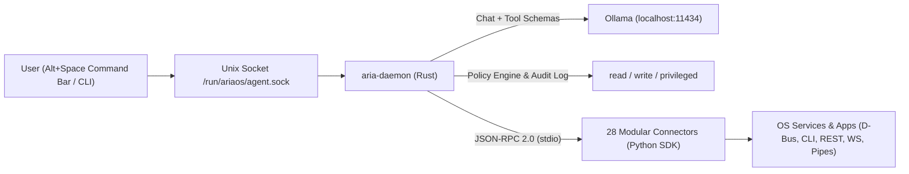

# AriaOS Wiki

Welcome to the official **AriaOS** documentation — an **Arch Linux + KDE Plasma 6** distribution where a local AI agent (`aria-daemon` + Ollama) is built into the operating system as a native subsystem.

## Core Principles

1. **Local Sovereignty & Privacy**: All LLM inference and tool execution run locally on your hardware via `ollama` and `aria-daemon` — no external cloud API is required.
2. **API-First Control (No Fragile Mouse Simulation)**: Programs are controlled directly through native IPC and program APIs (D-Bus / MPRIS2, Chromium CDP, OBS WebSocket v5, Audacity `mod-script-pipe`, LibreOffice headless/UNO, `pacman`, Docker/Podman, SQLite, XML/ZIP inspection).
3. **Zero-Destruction Safety Policy**: Every tool declares a strict risk tier (`read`, `write`, `privileged`). Destructive overwrites are blocked by design, and mutating/privileged calls require explicit user approval.
4. **Full Desktop + Creative + Security + Dev Ecosystem**: Ships with KDE Plasma 6, LibreOffice, Okular, Thunderbird, Firefox/Brave, VLC, Elisa, GIMP, Krita, Blender, Audacity, Kdenlive, OBS Studio, plus modular installers (`ariaos-install-apps`) for 50+ creative, reverse-engineering, container, virtualization, database, and gaming applications.

## High-Level Architecture

## Wiki Sections

- **[Operating System & Branding](Operating-System-and-Branding)**: Arch base, KDE Plasma 6, live user, animated Plymouth boot video, Syslinux/UEFI, SDDM, and wallpaper/icon integration.
- **[AI Subsystem & Daemon](AI-Subsystem-and-Daemon)**: How `aria-daemon` orchestrates Ollama tool calling and connector IPC.
- **[Security & Trust Tiers](Security-and-Trust-Tiers)**: Permission gates, interactive confirmation flow, and JSONL audit logging.
- **[Command Bar Guide](Command-Bar-Guide)**: Floating PyQt6 command launcher (`Alt+Space`), slash commands, and CLI fallback.
- **[Connectors Catalog](Connectors-Catalog)**: Complete reference of all 28 connectors and the 50+ app ecosystem.
- **[Developer SDK & Protocol](Developer-SDK-and-Protocol)**: `connector.schema.json`, JSON-RPC 2.0 over `stdio`, and Python `aria_sdk`.
- **[ISO Build & Arch Packaging](Building-ISO-and-Packaging)**: Building bootable ISOs via `os/scripts/build-iso.sh`, Arch `PKGBUILD` recipes, `[multilib]`, and AUR local repos.
